# Reposición inteligente v2: diagramas de implementación

Este documento complementa
`replenishment-intelligent-v2-functional.md` y define el recorrido, los datos,
las visualizaciones y la persistencia necesarios para que la recomendación sea
entendible y auditable.

## 1. Recorrido operativo

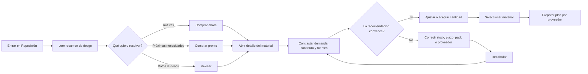

Principio: la aplicación propone y explica; la persona selecciona y confirma.

## 2. Fuentes y cálculo

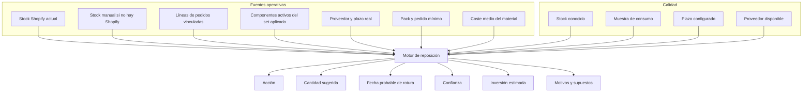

El coste se usa únicamente para valorar la inversión. Nunca cambia la urgencia
ni la cantidad física recomendada.

## 3. Demanda observada

La ficha mostrará doce semanas con dos fuentes apiladas y una línea de demanda
ponderada.

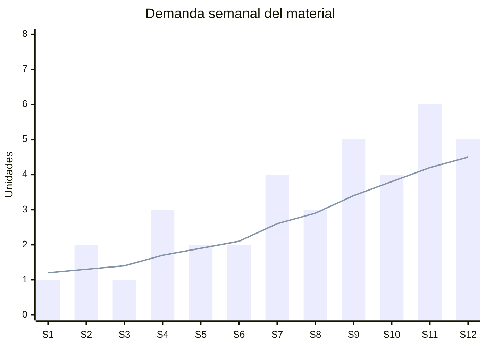

Implementación real:

- Barras verdes: consumo directo de líneas Shopify.
- Barras doradas: consumo indirecto por sets activos.
- Línea: demanda semanal derivada de la ponderación 30/90 días.
- Tooltip: semana, directo, sets, total y pedidos implicados.
- Una semana sin consumo se muestra como cero, no como dato ausente.

## 4. Proyección de stock

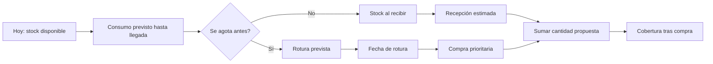

### Series del gráfico

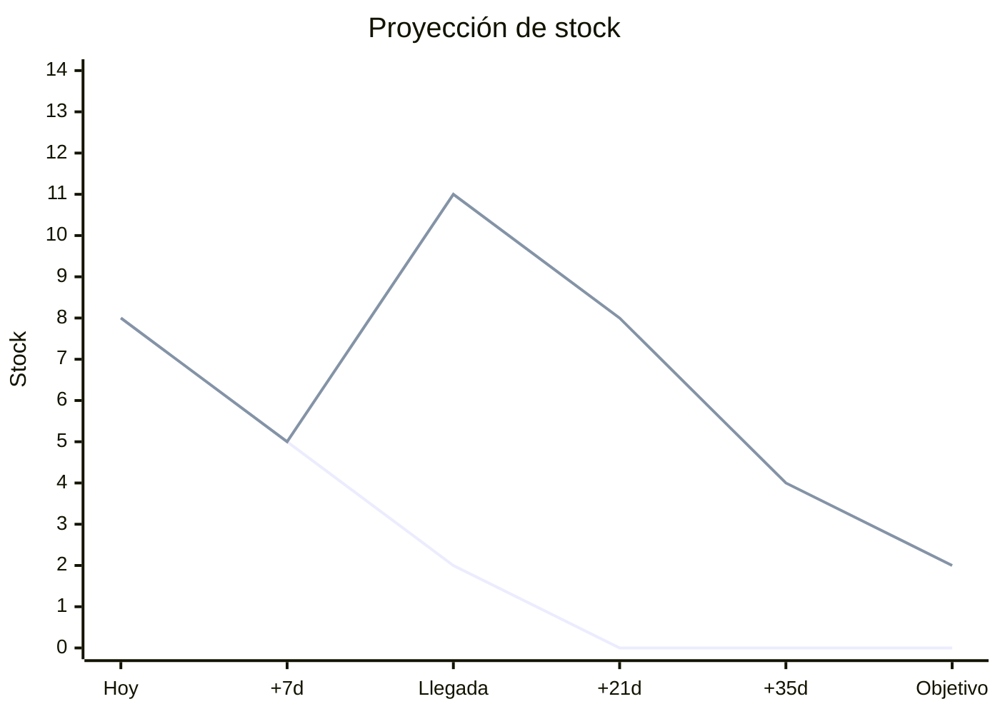

- Línea roja: proyección sin comprar.
- Línea verde: proyección incluyendo la compra propuesta en la fecha de llegada.
- Línea horizontal: punto de seguridad.
- Banda suave: cobertura objetivo.
- Marcadores: fecha de rotura, fecha de pedido y fecha estimada de recepción.

La proyección usa demanda constante ponderada en la primera versión. No se
presentará como predicción estadística ni como stock histórico.

## 5. Urgencia y confianza

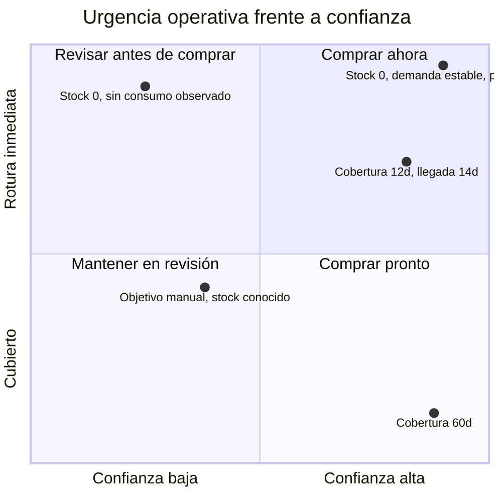

Consecuencia visual:

- El color principal de la fila representa urgencia.
- La etiqueta `Alta`, `Media`, `Manual` o `Incompleta` representa confianza.
- Nunca se usa el mismo color o etiqueta para ambas dimensiones.

## 6. Explicación de una cantidad

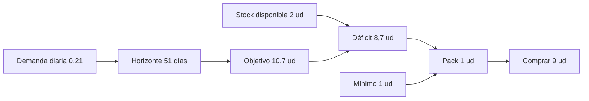

El detalle mostrará también la descomposición del objetivo:

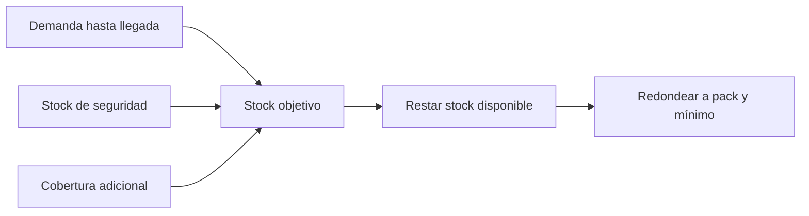

## 7. Arquitectura de pantalla

```mermaid
flowchart TB
  H[Cabecera Materiales + navegación] --> K[4 KPI de decisión]
  K --> O[Resumen de riesgo | Compra por proveedor]
  O --> F[Filtros + acciones + supuestos]
  F --> S[Barra de selección supervisada]
  S --> T[Tabla densa de materiales]
  T --> X[Detalle desplegable]
  X --> X1[Fórmula]
  X --> X2[Demanda 12 semanas]
  X --> X3[Proyección de stock]
  X --> X4[Fuentes y calidad]
  X --> X5[Simulador de cantidad y fecha]
  T --> M[Ver ficha completa del material]
  M --> M1[Sección Demanda y reposición]
```

### Escritorio

- Resumen y lista permanecen en la misma vista.
- Solo una fila puede mostrar gráficos expandidos simultáneamente.
- Los gráficos se organizan en dos columnas: demanda y proyección.
- La fórmula y los supuestos quedan debajo de los gráficos.

### Móvil

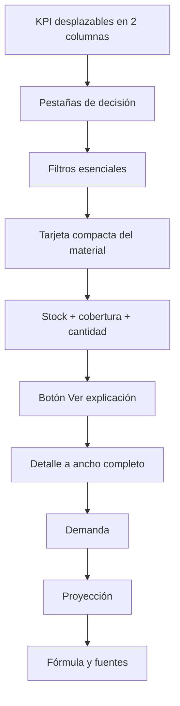

En móvil se ocultan métricas secundarias de la fila, pero nunca el motivo, la
confianza, la cobertura ni la cantidad propuesta.

## 8. Datos históricos necesarios

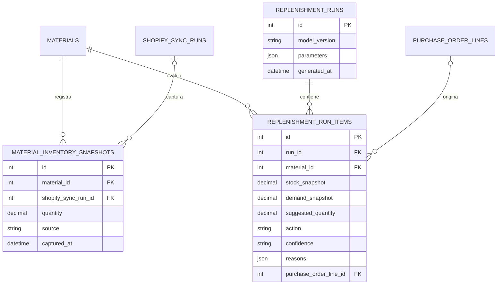

### Política de snapshots

1. Guardar stock por material al terminar una sincronización Shopify correcta.
2. No duplicar un snapshot si cantidad y sincronización no han cambiado.
3. Guardar una ejecución de reposición solo cuando se abre la vista tras datos
   nuevos, cuando se fuerza un recálculo o cuando se crea un plan.
4. Conservar el modelo y parámetros usados para poder explicar resultados
   históricos aunque la fórmula evolucione.

## 9. Secuencia de sincronización y recálculo

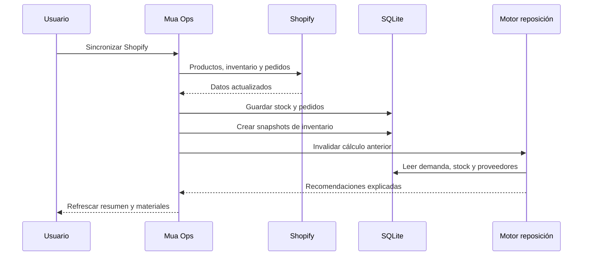

## 10. Simulador supervisado

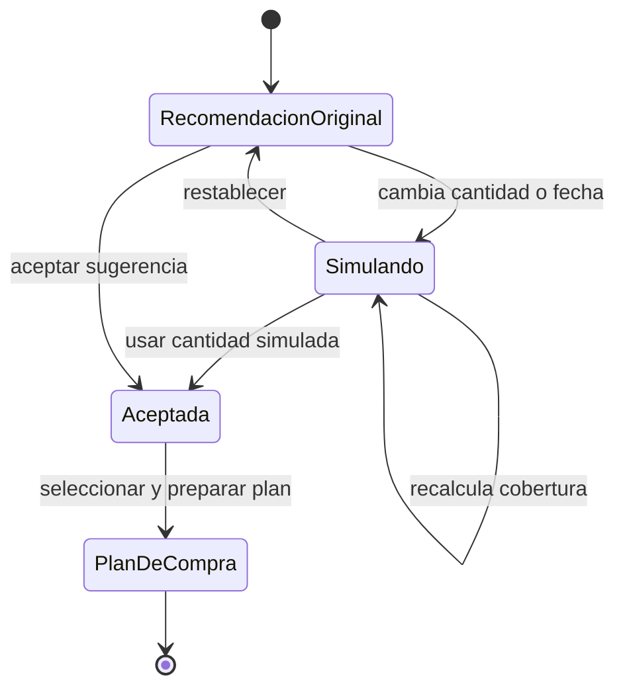

El simulador no cambia el stock, el material ni la recomendación persistida.
Solo define la cantidad supervisada que se enviará al plan de compra.

## 11. Fases de implementación

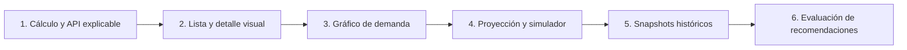

1. Consolidar acciones, confianza, fórmula y fuentes.
2. Afinar la vista principal y el detalle desplegable.
3. Añadir agregación semanal directa/sets y gráfico de doce semanas.
4. Añadir proyección sin/con compra y simulación local.
5. Persistir snapshots en sincronizaciones futuras.
6. Comparar recomendación, compra y rotura posterior para calibrar el modelo.

## 12. Validación funcional

- La suma semanal de demanda reconcilia con consumo 30/90 días.
- La fecha de rotura coincide con `stock / demanda diaria`.
- La proyección con compra aplica el incremento solo en la fecha de llegada.
- El simulador no persiste hasta preparar el plan.
- Un material manual nunca aparece dentro de selección fiable.
- Los snapshots no modifican Shopify ni el stock operativo.
- El detalle histórico indica claramente datos reales frente a proyecciones.
