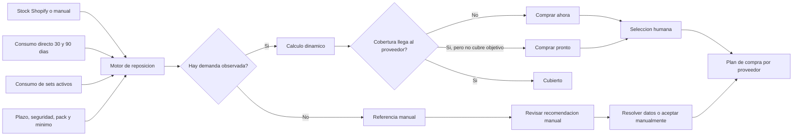
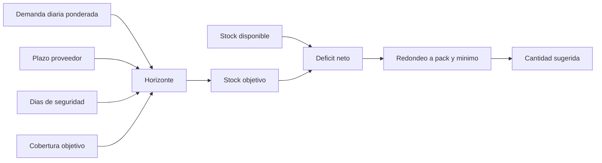
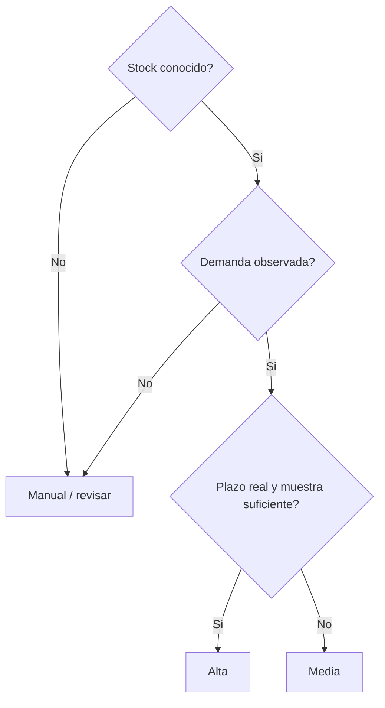

# Reposicion inteligente v2

Los diagramas detallados de experiencia, proyeccion, persistencia y secuencia
de implementacion se encuentran en
`replenishment-intelligent-v2-diagrams.md`.

## Objetivo

Convertir inventario y consumo en una decision supervisada que responda cuatro
preguntas: que comprar, cuando, cuanto y con que nivel de confianza.

La urgencia y la confianza son dimensiones distintas. Un material puede estar
agotado y, aun asi, requerir revision si no existe demanda observada o el stock
no es fiable.

## Flujo de decision

## Formula

- Demanda diaria: `0,7 x consumo diario 30d + 0,3 x consumo diario 90d`.
- Stock objetivo: `demanda diaria x (plazo + seguridad + cobertura objetivo)`.
- Deficit: `max(0, stock objetivo - max(0, stock disponible))`.
- Compra: deficit redondeado al pack y respetando el minimo de pedido.

## Clasificacion

| Accion | Regla principal | Seleccion automatica |
| --- | --- | --- |
| Comprar ahora | Demanda observada y cobertura menor o igual a plazo + seguridad | No |
| Comprar pronto | Demanda observada, existe deficit y la cobertura supera la llegada | No |
| Revisar | Stock desconocido, sin proveedor o fallback manual sin demanda | No |
| Cubierto | Sin deficit dinamico y sin riesgo inmediato | No |

El control `Seleccionar recomendaciones fiables` selecciona bajo accion humana
solo filas de compra con confianza alta, proveedor y cantidad valida. Nunca se
preseleccionan filas al abrir la vista.

## Confianza

- Alta: stock conocido, proveedor con plazo configurado y al menos 3 unidades
  consumidas en 90 dias.
- Media: demanda observada, pero plazo por defecto o muestra inferior.
- Manual: no hay demanda y se usan minimo/objetivo configurados.
- Incompleta: no se conoce el stock o falta proveedor para comprar.

El coste no determina la cantidad ni la urgencia. Solo afecta a la estimacion
economica y se muestra como dato incompleto cuando falta.

## Arquitectura de la vista

1. Resumen: riesgo de rotura, compras con evidencia, inversion conocida y
   revisiones pendientes.
2. Distribucion de riesgo y resumen por proveedor.
3. Filtros por accion, proveedor, confianza y familia.
4. Lista densa con imagen, stock, demanda, cobertura, cantidad, coste,
   confianza y motivo.
5. Detalle desplegable con formula, fuentes y supuestos.
6. Barra de seleccion explicita para preparar el plan de compra.

## Criterios de aceptacion

- Un fallback manual nunca aparece como recomendacion fiable automatica.
- Ningun material aparece seleccionado al entrar.
- Urgencia y confianza se muestran por separado.
- Cada cantidad puede explicarse con stock, demanda, horizonte y redondeo.
- Los componentes desactivados del set no generan consumo.
- La falta de coste no oculta una rotura, pero deja la inversion como parcial.
- La vista es operativa en escritorio y movil sin perder el motivo principal.
